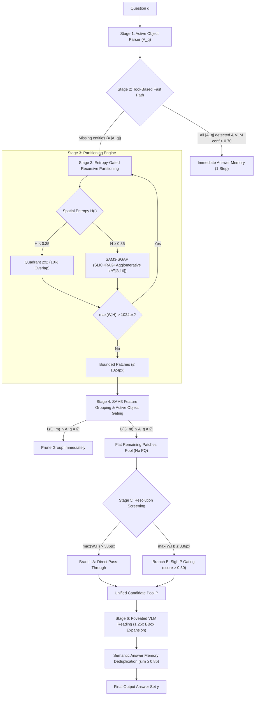

# MSSearch: Dual-Path Multi-Source Visual Search Engine

[](https://www.python.org/downloads/)
[](https://pytorch.org/)
[](LICENSE)
[](https://www.nvidia.com)

**MSSearch** is a high-resolution, multi-image visual search engine engineered to locate and read fine-grained target evidence across multi-canvas environments (e.g. $N = 20$ high-resolution $4000 \times 4000\text{px}$ images with variable evidence cardinality $K \in [1, 5]$).

MSSearch replaces greedy priority-queue tree search with a **Dual-Path Decoupled Architecture**: a fast-path instant canvas check for salient targets and an exhaustive, entropy-partitioned search branch with zero-redundant feature reuse.

---

## 1. System Architecture



---

## 2. The 6-Stage Decoupled Pipeline

| Stage | Module | Key Responsibility | Algorithmic Mechanism |
| :--- | :--- | :--- | :--- |
| **Stage 1** | `stage1_parser.py` | Active Object Extraction ($\mathcal{A}_q$) | Qwen2.5-VL in-context JSON extraction + SpaCy NLP noun chunk fallback. Filters demonstratives/pronouns. |
| **Stage 2** | `stage2_fast_path.py` | Full-Canvas Fast Path | SAM3 canvas detection + Qwen2.5-VL existence gating ($P(\text{"Yes"}) > 0.70$). Caches vision features $\mathbf{H}_e$. |
| **Stage 3** | `stage3_partitioning.py` | Entropy-Gated Partitioning | Tri-factor entropy ($H < 0.35 \to 2\times 2$ quadrants; $H \ge 0.35 \to$ SAM3-SGAP with $k^* \in [8, 16]$). Enforces $\le 1024\text{px}$ recursive invariant. |
| **Stage 4** | `stage4_grouping_gating.py` | Feature Grouping & Gating | Agglomerative clustering on cached SAM3 features ($\cos \ge 0.80$). Single-step background cluster pruning. |
| **Stage 5** | `stage5_screening.py` | Resolution Screening | **Branch A**: Patches $> 336\text{px}$ pass through directly.<br>**Branch B**: Patches $\le 336\text{px}$ screened via SigLIP-base ($\ge 0.50$). |
| **Stage 6** | `stage6_foveated_reader.py` | Foveated VLM Reading | $1.25\times$ bbox expansion. Exhaustive reading across candidate pool. Semantic deduplication ($\text{sim} \ge 0.85$). |

---

## 3. Core Architectural Guarantees

1. **Zero Redundant Feature Computation**:
   - The dense vision feature map $\mathbf{H}_e \in \mathbb{R}^{256 \times 72 \times 72}$ extracted during Stage 2 canvas detection is cached per image. Stage 3 SAM3-SGAP directly slices $\mathbf{H}_e$ without re-running the SAM3 image encoder.
   - Stage 3 computes average-pooled feature vectors for all bounded patches ($\le 1024\text{px}$). Stage 4 cosine grouping clusters these vectors with zero neural network forward passes.
2. **Zero-Heuristic Path Resolution**:
   - Strictly direct path concatenation (`os.path.join(base_data_dir, img_rel)`), preventing ambiguous fuzzy matching across nested Kaggle datasets.
3. **Exhaustive Recall Guarantee**:
   - Priority queues and greedy early stopping are purged from the search branch; every surviving candidate patch is systematically evaluated, ensuring full recall when evidence cardinality $K \in [1, 5]$.
4. **Prompt Ablation Toggles**:
   - `enable_visual_prompt_bbox: bool`: Draws visual bounding box on composite crops.
   - `enable_textual_prompt_coords: bool`: Appends normalized coordinates to text prompts.
5. **Verbose Diagnostic Tracing**:
   - Full diagnostic logging on fallback vs non-fallback execution branches (`[Non-Fallback]`, `[Fallback]`, `[Fallback to Stage 3]`).

---

## 4. Dual-GPU Asymmetric Hardware Budget (2x NVIDIA T4)

Engineered specifically for Kaggle 2x Tesla T4 (16GB VRAM each):

| Device | Resident Models & Layers | Static Footprint | Dynamic Headroom | Purpose |
| :--- | :--- | :--- | :--- | :--- |
| **GPU 0 (`cuda:0`)** | Qwen2.5-VL Vision Tower + Layers 0--14 + **SigLIP-base** | $\approx 8.65\text{ GB}$ | **$\approx 6.71\text{ GB}$** | Visual token processing & fast patch screening |
| **GPU 1 (`cuda:1`)** | Qwen2.5-VL Layers 15--27 + Head + **SAM3 Foundation** | $\approx 11.70\text{ GB}$ | **$\approx 3.66\text{ GB}$** | Dense segmentation & text generation |
| **CPU / System RAM** | **SpaCy NLP Parser** (`en_core_web_sm`) | $\approx 0.15\text{ GB}$ | $\approx 28\text{ GB}$ | Linguistic noun phrase parsing & graph construction |

---

## 5. Repository Structure

```
MSSearch/
├── README.md                       # Comprehensive repository documentation
├── requirements.txt                # Python dependencies
├── notebooks/                      # Standalone interactive notebooks
│   └── run_mssearch_2xt4_dual_track.ipynb # Dual-track Kaggle 2xT4 evaluation notebook
├── mssearch/
│   ├── __init__.py
│   ├── config.py                   # Typed MSSearchConfig dataclass & ablation toggles
│   ├── MSSearch.py                 # Master MultiSourceSearchEngine orchestrator
│   ├── perform_MSSearch.py         # Multi-source batch dataset runner
│   ├── run_eval_mssearch.sh        # Shell execution script with Kaggle default paths
│   ├── stages/                     # Decoupled stage modules
│   │   ├── __init__.py
│   │   ├── stage1_parser.py        # Question parser & active object extractor
│   │   ├── stage2_fast_path.py     # Canvas SAM3 detection & VLM existence check
│   │   ├── stage3_partitioning.py  # Tri-factor entropy & SAM3-SGAP partitioning
│   │   ├── stage4_grouping_gating.py # Cosine feature grouping & active object gating
│   │   ├── stage5_screening.py     # Dual-branch resolution screening (Branch A/B)
│   │   └── stage6_foveated_reader.py # 1.25x bbox padding & semantic deduplication
│   └── models/
│       ├── __init__.py
│       ├── modeling_qwenvl.py      # Dual-T4 sharded Qwen2.5-VL adapter
│       ├── modeling_sam3.py        # SAM3 adapter with SLIC/RAG tools
│       ├── modeling_siglip.py      # SigLIP-base patch scorer on GPU 0
│       └── utils.py                # Bounding box & overlap geometry utilities
```

---

## 6. Getting Started

### 6.1 Installation
```bash
git clone https://github.com/tothanhdat2006/MSSearch.git
cd MSSearch
pip install -r requirements.txt
pip install iopath decord ftfy scikit-image scikit-learn networkx
python -m spacy download en_core_web_sm
```

### 6.2 Running on Kaggle (2x Tesla T4)
Launch [`notebooks/run_mssearch_2xt4_dual_track.ipynb`](notebooks/run_mssearch_2xt4_dual_track.ipynb):
- **Track A**: Benchmarks on HRBench8K ($K=1$ single candidate image).
- **Track B**: Benchmarks on the Multi-Source Visual Search dataset ($K>1, N=20$ candidate images per scene).
- Includes 3-sample smoke tests, latency profiling, and automated 4-panel publication figure generation.

### 6.3 Command Line Batch Evaluation
```bash
python -m mssearch.perform_MSSearch \
    --annotation-path /path/to/annotations.json \
    --base-data-dir /path/to/images \
    --sam3-checkpoint /path/to/sam3.pt \
    --output-dir /path/to/results \
    --partition-mode hybrid \
    --num-chunks 1 \
    --chunk-idx 0 \
    --verbose
```

---

## 7. Configuration & Ablation Matrix

All hyperparameters are controlled via `MSSearchConfig`:

```python
from mssearch.config import MSSearchConfig

config = MSSearchConfig(
    enable_fast_path=True,             # Toggle Stage 2 fast canvas check
    fast_path_conf_threshold=0.70,     # Existence confidence exit threshold
    entropy_threshold=0.35,            # Partitioning decision boundary H(I)
    partition_mode="hybrid",           # "hybrid", "quadrant_only", "sgap_only"
    sgap_min_splits=8,                 # Minimum SGAP clusters k*
    sgap_max_splits=16,                # Maximum SGAP clusters k*
    max_patch_size=1024,               # Recursive split bounding invariant
    enable_feature_grouping=True,      # Toggle Stage 4 SAM3 feature grouping
    grouping_sim_threshold=0.80,       # Grouping cosine similarity threshold
    branch_b_size_cutoff=336,          # Stage 5 resolution division threshold
    branch_b_score_threshold=0.50,     # Stage 5 SigLIP filter threshold
    bbox_expansion_factor=1.25,        # Stage 6 bounding box expansion
    answer_dedup_similarity=0.85,      # Stage 6 semantic answer deduplication
    enable_visual_prompt_bbox=False,   # Draw visual bounding box on crop
    enable_textual_prompt_coords=False,# Append text coordinates to query
    verbose=True                       # Diagnostic fallback/non-fallback logging
)
```

---

## 8. Citation & Acknowledgements
Built upon architectural principles from SAM3, SigLIP, and Qwen2.5-VL for scalable high-resolution visual question answering.