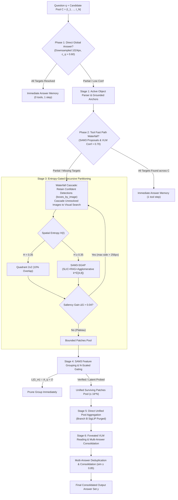

# MSSearch: Dual-Path Multi-Source Visual Search Engine

[](https://www.python.org/downloads/)
[](https://pytorch.org/)
[](LICENSE)
[](https://www.nvidia.com)

**MSSearch** is a high-resolution, multi-image visual search engine engineered to locate, verify, and read fine-grained target evidence distributed across multi-canvas environments (e.g. $N = 20$ high-resolution $4000 \times 4000\text{px}$ to $8000 \times 8000\text{px}$ images with variable evidence cardinality $K \in [1, 5]$).

MSSearch replaces greedy priority-queue tree search with a **3-Tier Cascade & Dual-Path Decoupled Architecture**: transitioning dynamically from a zero-tool direct root answering view down to a tool-based canvas fast path with waterfall cascade, and an exhaustive, entropy-partitioned visual search branch with zero-redundant feature reuse.

---

## 1. System Architecture



---

## 2. The 6-Stage Decoupled Pipeline

| Stage | Module | Key Responsibility | Algorithmic Mechanism |
| :--- | :--- | :--- | :--- |
| **Stage 1** | `stage1_parser.py` | Active Object Extraction & Anchor Discovery ($\mathcal{A}_q$) | Qwen2.5-VL in-context JSON extraction + Anchor-first ordering. Fallback to Image-Grounded Anchor Discovery ($1024\text{px}$) when question lacks physical host entities. |
| **Stage 2** | `stage2_fast_path.py` | 2-Gate Early Assessment & Fast Path Waterfall | **Phase 1**: Direct global root logit probe ($c_q > 0.60$).<br>**Phase 2**: Full-canvas SAM3 detection + crop existence gating ($P(\text{"Yes"}) > 0.70$). Implements **Waterfall Cascade** over candidate pool $\mathcal{C}$ with per-image localization (`boxes_by_image`) and caches vision features $\mathbf{H}_e^{(k)}$. |
| **Stage 3** | `stage3_partitioning.py` | Entropy-Gated Partitioning & Saliency Plateau | Tri-factor entropy ($H < 0.35 \to 2\times 2$ quadrants; $H \ge 0.35 \to$ SAM3-SGAP with $k^* \in [4, 8]$). Halts dynamically via Saliency Plateau ($\Delta S \le 0.04$). Reuses cached Stage 2 SAM3 features. |
| **Stage 4** | `stage4_grouping_gating.py` | Feature Grouping & $N$-Scaled Gating | Agglomerative clustering on cached SAM3 features ($\cos \ge 0.80$). Caps speculative latent queries ($8 \times N$) and prioritized SAM3 scans ($16 \times N$) with global retention cap ($16 \times N$). |
| **Stage 5** | `stage5_screening.py` | Direct Unified Pool Aggregation | **Direct Pass-Through**: All surviving Stage 4 patches pass directly into Stage 6. Legacy Branch B SigLIP thresholding purged in v3 to prevent false-negative rejection of small fine-grained targets. |
| **Stage 6** | `stage6_foveated_reader.py` | Foveated VLM Reading & Multi-Answer Consolidation | $1.25\times$ bbox expansion. In `multi_answer_mode=True`, early consensus exit is deactivated, reading all candidate crops across $N$ images and consolidating unique factual extractions into semicolon-separated natural language. |

---

## 3. Core Architectural Guarantees

1. **Multi-Source Waterfall Cascade (Partial Early Exit)**:
   - Simultaneously assesses Phase 1 (Direct Global) and Phase 2 (Tool Fast Path) across all $N$ candidate images. Confident answers are captured immediately with per-image localization (`boxes_by_image`), while unresolved candidate images waterfall into Stage 3 Partitioning without abandoning visual search.
2. **Linear Budget Scaling ($N \times \text{Budget}$)**:
   - Stage 4 SAM3 patch scans ($16 \times N$), speculative latent queries ($8 \times N$), and global retention limits ($16 \times N$) automatically scale linearly with candidate pool size $N$, maintaining constant visual coverage density without compute starvation.
3. **Open-Set Multi-Answer Consolidation (`multi_answer_mode`)**:
   - In multi-answer visual search ($K \in [1, 5]$), early consensus exit is safely bypassed (`enable_early_consensus_exit = False`), evaluating all candidate evidence crops and consolidating unique structured answers into concise semicolon-separated text.
4. **Zero Redundant Feature Computation**:
   - The dense vision feature map $\mathbf{H}_e \in \mathbb{R}^{256 \times 72 \times 72}$ extracted during Stage 2 canvas detection is cached per image. Stage 3 SAM3-SGAP directly slices $\mathbf{H}_e$ without re-running the SAM3 image encoder.
   - Stage 3 computes average-pooled feature vectors for all bounded patches. Stage 4 cosine grouping clusters these vectors with zero neural network forward passes.
5. **Clean Foveated Reading Pipeline**:
   - Strictly conforms to concise `<image>\n<question>` query formatting without artificial visual bounding box distortions or fragile prompt tags.
6. **Zero-Heuristic Path Resolution**:
   - Strictly direct path concatenation (`os.path.join(base_data_dir, img_rel)`), preventing ambiguous fuzzy matching across nested Kaggle datasets.
7. **Verbose Diagnostic Tracing**:
   - Full diagnostic telemetry across fallback vs non-fallback execution paths (`[Non-Fallback]`, `[Fallback]`, `[Waterfall Cascade]`).

---

## 4. Dual-GPU Asymmetric Hardware Budget (2x NVIDIA T4)

Engineered specifically for Kaggle 2x Tesla T4 (16GB VRAM each):

| Device | Resident Models & Layers | Static Footprint | Dynamic Headroom | Purpose |
| :--- | :--- | :--- | :--- | :--- |
| **GPU 0 (`cuda:0`)** | Qwen2.5-VL Vision Tower + Layers 0--14 + **SigLIP-base** | $\approx 8.65\text{ GB}$ | **$\approx 6.71\text{ GB}$** | Visual token processing & fast patch screening |
| **GPU 1 (`cuda:1`)** | Qwen2.5-VL Layers 15--27 + Head + **SAM3 Foundation** | $\approx 11.70\text{ GB}$ | **$\approx 3.66\text{ GB}$** | Dense segmentation & text generation |
| **CPU / System RAM** | **SpaCy NLP Parser** (`en_core_web_sm`) | $\approx 0.15\text{ GB}$ | $\approx 28\text{ GB}$ | Linguistic noun phrase parsing & graph construction |

---

## 5. Repository Structure

```
MSSearch/
├── README.md                       # Comprehensive repository documentation
├── requirements.txt                # Python dependencies
├── notebooks/                      # Standalone interactive notebooks
│   ├── run_mssearch_2xt4_dual_track.ipynb     # Dual-track Kaggle 2xT4 evaluation notebook
│   └── debug_mssearch_multisource_stages.ipynb # Interactive visual stage-by-stage debugger
├── pilot/                          # Standalone CLI runners and diagnostic suites
│   ├── multisource_pilot10/        # 10-sample pilot evaluation suite
│   │   ├── run_pilot.py            # Batch pilot runner with multi-source telemetry
│   │   └── run_pilot.sh            # Production execution wrapper
│   └── multisource_hrbench/        # Local stage-by-stage visual diagnostic pipeline
│       ├── debug_stages.py         # Full 6-stage debugger matching notebook Cell 1-10
│       ├── render_stages.py        # Diagnostic image renderer with bounding box overlays
│       └── run_debug.sh            # Local Ubuntu CLI execution wrapper
├── mssearch/
│   ├── __init__.py
│   ├── config.py                   # Typed MSSearchConfig dataclass & ablation toggles
│   ├── MSSearch.py                 # Master MultiSourceSearchEngine orchestrator
│   ├── perform_MSSearch.py         # Multi-source batch dataset runner
│   ├── run_eval_mssearch.sh        # Shell execution script with Kaggle default paths
│   ├── stages/                     # Decoupled stage modules
│   │   ├── __init__.py
│   │   ├── stage1_parser.py        # Question parser, grounded anchors & active objects
│   │   ├── stage2_fast_path.py     # Canvas SAM3 detection, boxes_by_image & waterfall
│   │   ├── stage3_partitioning.py  # Tri-factor entropy, SAM3-SGAP & saliency plateau
│   │   ├── stage4_grouping_gating.py # Cosine feature grouping & N-scaled gating
│   │   ├── stage5_screening.py     # Direct unified pool aggregation (Branch B purged)
│   │   └── stage6_foveated_reader.py # 1.25x bbox padding & multi-answer consolidation
│   └── models/
│       ├── __init__.py
│       ├── modeling_qwenvl.py      # Dual-T4 sharded Qwen2.5-VL adapter
│       ├── modeling_sam3.py        # SAM3 adapter with SLIC/RAG tools
│       ├── modeling_siglip.py      # SigLIP-base patch scorer on GPU 0
│       └── utils.py                # Bounding box & overlap geometry utilities
```

---

## 6. Getting Started

### 6.1 Installation
```bash
git clone https://github.com/tothanhdat2006/MSSearch.git
cd MSSearch
pip install -r requirements.txt
pip install iopath decord ftfy scikit-image scikit-learn networkx
python -m spacy download en_core_web_sm
```

### 6.2 Running on Kaggle (2x Tesla T4)
Launch [`notebooks/run_mssearch_2xt4_dual_track.ipynb`](notebooks/run_mssearch_2xt4_dual_track.ipynb):
- **Track A**: Benchmarks on HRBench8K ($K=1$ single candidate image).
- **Track B**: Benchmarks on the Multi-Source Visual Search dataset ($K>1, N=20$ candidate images per scene).
- Includes 3-sample smoke tests, latency profiling, and automated 4-panel publication figure generation.

### 6.3 Local Visual Stage-by-Stage Diagnostics (HRBench)
Execute the headless visual diagnostic suite on HRBench:
```bash
cd pilot/multisource_hrbench
bash run_debug.sh --num_samples 5 --save_visuals all
```

### 6.4 Full Dataset Benchmark Evaluation
Run end-to-end multi-stage visual search across all 999 samples with crash-resilient auto-resume:
```bash
cd pilot/multisource_hrbench
bash run_all.sh
```

### 6.5 Direct Vanilla VLM Baseline Benchmark
Evaluate vanilla direct VLM answering without visual search or SAM3:
```bash
cd pilot/multisource_hrbench
bash run_baseline.sh                     # Interleaved multi-image baseline (N candidate images)
bash run_baseline.sh --direct_target_only # Single-image vanilla baseline (N=1 target only)
```

### 6.6 Command Line Batch Evaluation
```bash
python -m mssearch.perform_MSSearch \
    --annotation-path /path/to/annotations.json \
    --base-data-dir /path/to/images \
    --sam3-checkpoint /path/to/sam3.pt \
    --output-dir /path/to/results \
    --partition-mode hybrid \
    --num-chunks 1 \
    --chunk-idx 0 \
    --verbose
```

---

## 7. Configuration & Master Ablation Matrix

All hyperparameters are controlled via `MSSearchConfig`:

```python
from mssearch.config import MSSearchConfig

config = MSSearchConfig(
    # Stage 1: Question Parsing & Image-Grounded Anchors
    use_mllm_object_parser=True,           # Zero-shot LLM object extraction
    enable_anchor_first_ordering=True,     # Prioritize physical hosts over abstract targets
    enable_image_grounded_anchors=True,    # Low-res canvas glimpse when text lacks physical anchors
    image_grounded_anchor_resolution=1024, # Resolution for anchor discovery glimpse

    # Stage 2: 2-Gate Early Assessment & Fast Path Waterfall
    enable_direct_answer=True,             # Phase 1: Direct Global Answer via logit probe
    direct_answer_conf_threshold=0.60,     # Logit confidence threshold c_q [-1, 1] for direct answer
    enable_fast_path=True,                 # Phase 2: Tool-Based Fast Path via SAM3 Proposals
    fast_path_conf_threshold=0.70,         # Existence confidence threshold for fast path instant exit

    # Stage 3: Entropy-Gated Recursive Partitioning & Saliency Plateau
    entropy_threshold=0.35,                # Partitioning decision boundary H(I)
    partition_mode="hybrid",               # "hybrid", "quadrant_only", "sgap_only"
    partition_stopping_mode="saliency_plateau", # Dynamic semantic zoom stop vs fixed size
    saliency_plateau_gain_threshold=0.04,  # Saliency gain (max_child - parent) justifying split
    min_plateau_size=256,                  # Minimum dimension floor for dynamic zoom
    max_plateau_size=1536,                 # Maximum dimension ceiling before forced split

    # Stage 4: Feature Grouping & N-Scaled Gating
    enable_feature_grouping=True,          # Cosine clustering on cached SAM3 features
    grouping_sim_threshold=0.80,           # Cosine grouping similarity threshold
    enable_latent_gating=True,             # Speculative VLM query on centroid if no SAM3 det
    latent_prompt_mode="question_aware",   # Contextual QA prompt vs target noun prompt
    max_latent_evals=8,                    # Cap speculative VLM checks (scaled by N)
    max_sam3_eval_patches=16,              # Cap expensive SAM3 patch scans (scaled by N)
    max_retained_patches=16,               # Global candidate pool hard cap (scaled by N)

    # Stage 5: Direct Unified Candidate Pool Aggregation
    # Stage 5 Branch B SigLIP screening purged; surviving Stage 4 patches pass directly

    # Visual Pixel Budget & Resolution Controls
    min_pixels=3136,                       # 56 x 56 minimum patch resolution floor
    max_pixels=12845056,                   # 12.8M pixels (~3584 x 3584) default; auto-capped to 4194304 (2048 x 2048) for 32B checkpoints

    # Stage 6: Foveated VLM Reading & Multi-Answer Consolidation
    bbox_expansion_factor=1.25,            # Independent 25% margin padding per crop
    enable_early_consensus_exit=False,     # Deactivated in multi_answer_mode to read all evidence
    answer_dedup_similarity=0.85,          # Semantic deduplication similarity threshold
    multi_answer_mode=True,                # Open-set multi-source reading (K in [1, 5])
    scale_budgets_by_num_images=True,      # Linear budget scaling (N * Budget)

    verbose=True                           # Transparent fallback/waterfall diagnostic logging
)
```

---

## 8. Visual Pixel Budget & Budget Presets

### Visual Pixel Resolution Controls
Qwen2.5-VL native resolution is governed by `min_pixels` and `max_pixels`:
- **`min_pixels: 3136`**: Corresponds to $56 \times 56$ minimum patch resolution. Guarantees fine OCR digits and small signs are upscaled to preserve character legibility.
- **`max_pixels: 12,845,056` (~12.8M pixels, roughly $3584 \times 3584$)**: Default ceiling for 7B models (`Qwen2.5-VL-7B-Instruct`), supporting ultra-high-resolution ingestion.
- **`max_pixels: 4,194,304` (~4.2M pixels, $2048 \times 2048$)**: Automatically overridden for 32B checkpoints (`Qwen2.5-VL-32B-Instruct`) to prevent CUDA OOM from excessive SDPA self-attention memory allocations during multi-image forward passes.

### Budget Presets (`--budget`)
Control visual search depth:
- **`--budget large` (Default)**: Comprehensive visual search (`max_sam3_eval_patches=150`, `max_latent_evals=20`, `max_retained_patches=20`, `max_latent_repartition_patches_per_image=4`, `latent_repartition_threshold=0.0`, `answer_type="option_list"`).

---

## 9. VLM Backend Compatibility & Debugging Notes

When integrating custom or upstream MLLMs into `mssearch/models/`:
- **Unified Interface**: Every VLM wrapper class must implement `generate_response(image_pil=None, question: str = "", max_new_tokens: int = 128, **kwargs) -> str`.
  - When `image_pil is None`: routes to pure text generation (used by Stage 1 query parsing and Stage 5 candidate validation).
  - When `image_pil` is a `PIL.Image.Image` or `List[Image]`: routes to vision-language generation.
- **Visual Token Deduplication**: Prompts constructed in Stage 6 already prefix `<image>\n` (or `<image>`). Wrappers must check `if question.startswith("<image>\n")` before prepending default template visual tokens to prevent duplicate `<image><image>` tokens.
- **Stage 6 Error Surfacing**: In `mssearch/stages/stage6_foveated_reader.py`, generation exceptions on chunk 0 are printed unconditionally to expose missing methods or tensor shape mismatches without requiring `verbose=True`.

---

## 10. Citation & Acknowledgements
Built upon architectural principles from SAM3, SigLIP, and Qwen2.5-VL for scalable high-resolution visual question answering.